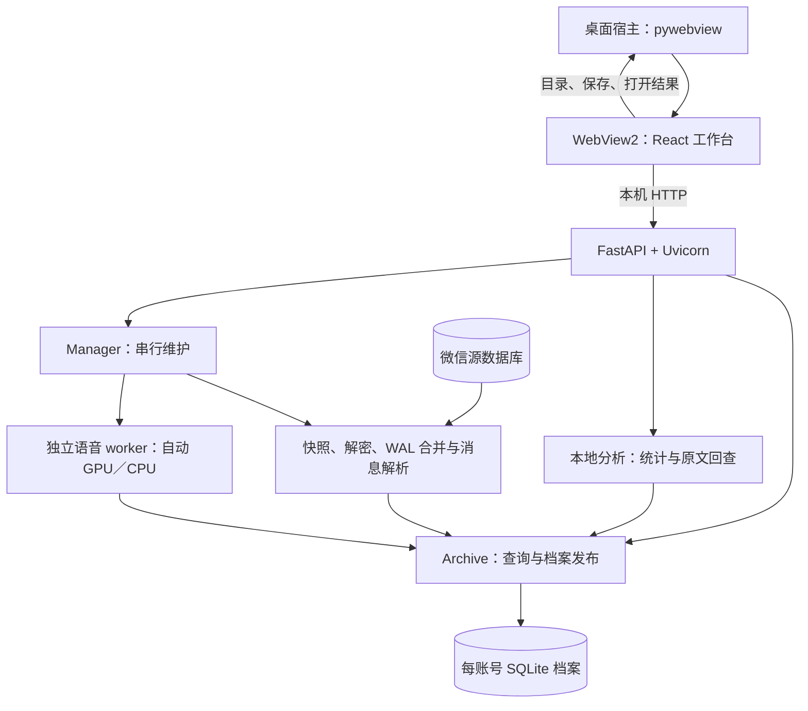
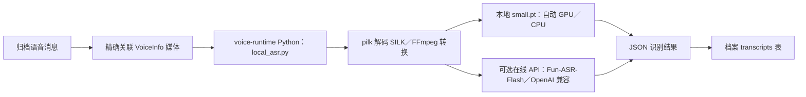

# 微信聊天档案工作台

Windows 本地桌面工作台，用于维护微信 4.x 聊天档案、阅读、正文及成功语音转写检索，并导出 TXT、JSON、ZIP。React + TypeScript 静态界面由本机 FastAPI 提供，桌面窗口使用 pywebview / EdgeChromium，档案使用 SQLite。密钥和聊天档案在本机处理；语音默认本地识别，也可自行配置在线 API。

阅读顺序：[启动与便携版](#使用便携版) → [使用流程](#首次准备) → [项目架构](#项目架构) → [开发与构建](#开发与构建) → [使用边界](#使用边界)。架构描述对应当前源码；已构建应用与发行 ZIP 是需要单独更新的程序副本。

技术报告：[分析等待与内存占用改进](docs/analysis-performance-improvement-report.md)，包含复杂度、数据结构、真实只读测量和验证边界；对应[验收记录](docs/analysis-improvement-acceptance.md)。

开发进度：[易用性改进方案](docs/usability-improvement-plan.md)中的 U1 首次准备、U2 批量选择与范围清理和 U3 维护任务停止已实施；实际验证分别见 [U1](docs/u1-acceptance.md)、[U2](docs/u2-acceptance.md)和 [U3](docs/u3-acceptance.md)验收记录。U4 便携恢复和 U5 分析导航仍为待开发规格。

## 使用便携版

解压基础包或完整语音包到可写目录，双击 **启动微信聊天档案.cmd**。用户电脑无需 Python、Conda、Node，也不运行开发服务器。保留整个文件夹结构；不要直接在 ZIP 内运行。

本项目工作区根目录的同名脚本会使用 `dist/` 中已构建的完整语音版（没有时使用基础版），并继续读取工作区原有 `local_data/`。发布包内的脚本则读取包根目录自己的 `local_data/`。开发源码请使用下文的开发命令启动。

- 基础版：目录与身份准备、密钥工具、导入、阅读、搜索、分析和导出。
- 完整语音版：另带独立语音 Python 运行时（默认包含 CUDA 12.1，自动选择 GPU / CPU）、Whisper small 模型、SILK 解码和 FFmpeg。首次转写不要求 GPU，也不会下载模型。
- 支持 Windows 10/11 x64，需要 .NET Framework 4.6.2 或更新版本、WebView2 Runtime；完整语音版还需要 Visual C++ 2015–2022 x64 Runtime。带原生前置组件的发布包在 `prerequisites/` 附有离线安装器，缺少时按启动提示安装，可能需要管理员权限或重启。构建机首次下载组件需要联网；已经备齐运行时与模型的应用在本机读取和识别数据。
- 看到桌面工作台或首次准备页面表示启动成功。启动失败时查看提示和实际数据目录中的 `logs/desktop.log`；发布包可使用 **诊断启动.cmd** 查看终端输出。工作区根目录入口使用项目原有数据目录，日志也写入该目录。

升级时退出应用，保留原来的 **local_data/**，替换程序文件及运行时；模型在 **models/**，也可保留。账号、密钥、档案、转写和阅读位置保存在 `local_data/`，程序不会将它们作为发布资源打包。已有外部源目录及导出结果不会自动删除。

## 首次准备

1. 点击“开始设置目录”，用“查找候选目录”比较完整路径、账号子目录、明文／加密及分片数，也可用原生选择器或粘贴微信 `db_storage`／明文库根目录。目录需含 `contact/contact.db` 和 `message/message_*.db`。检查后填写账号标签，核对归属并保存一次。改选目录会清空旧检查和勾选；相同目录保留原账号档案。
2. 加密库保持微信登录，手动点击“提取密钥”，或指定已有的本账号密钥 JSON。再点击“准备通讯录”。明文库跳过密钥步骤。业务操作由用户明确触发，不会随打开窗口自动执行。
3. 用公开微信号、内部 username、昵称或备注查找自己。没有微信号也可查昵称／备注；同名时按名称、微信号及内部编号选择自己的条目。无命中可改词、使用内部 username，或返回修改目录。核对导出显示名，勾选本人身份并“确认这是我并保存”。
4. 关闭设置，勾选会话后直接“导入所选”。需要持续更新时，可“替换关注范围”后在数据设置“更新关注会话”。待导入会话显示“待导入”，不会冒充零条消息。

设置顶部持续显示已保存目录、账号和本人身份，以及当前准备步骤和下一项主操作；未保存的编辑目录不改变提取目标。明文无需密钥；已有密钥直接准备通讯录，准备时验证。已有有效配置和重启直接进入阅读，不重复确认目录或身份；源目录或密钥失效只影响后续维护，已发布档案仍可阅读。

提取任务显示实际验证通过的数据库数量，部分通过标“部分完成”，可继续尝试准备通讯录。失败时在任务面板查看本次诊断、重试或返回数据设置修改目录／密钥。诊断只包含阶段、计数、系统码和退出码等字段，不包含密钥、salt 或内存原文；候选存在但全未通过时，先核对当前登录账号的存储位置，不能仅凭这一结果认定账号不匹配或权限不足。密钥文件无效或缺少本次必要库时，设置主操作回到密钥恢复；重新保存密钥路径后再次准备。

日常会话范围为源库存在对应消息表的会话与已有本地归档的并集，再排除隐藏项；主列表、待导入、更新全部及范围预览共用此口径。完整通讯录用于名称映射和身份查找，仅有通讯录记录的对象不进入日常范围。旧版保存的大通讯录自动按此口径展示，无需重新准备、逐项隐藏或清理。

准备通讯录时同时准备消息分片以识别会话，不导入消息正文或准备语音媒体；通讯录外历史会话自动纳入，源库消失但已有本地归档的会话仍可阅读。“发现历史会话”可重新准备并刷新源库会话。关注范围按账号保存；取消关注仍保留归档历史。维护串行进行，任务期间仍可阅读和导出已发布档案。诊断与验收见[会话范围异常修复报告](docs/session-scope-fix.md)。

在“处理任务”中可查看固定账号、对象、阶段和进度，并在可停止阶段点击“停止任务”。界面先显示正在停止，资源释放后才显示取消结果；重试使用原账号和对象。导入提交前停止会回滚本次导入，提交开始后等待实际结果。语音已逐条保存的结果保留，在线请求已发出时等待返回或超时。资源清理失败时在任务面板重试清理，完成前不能退出或开始新维护。

### 项目、关注与隐藏会话

左侧“项目”可切换全部会话、内置的“关注会话”和自建项目。点击“管理”新建、改名、删除项目；勾选会话后进入管理，可批量加入或移出项目，详情中也可管理单个会话的项目归属。一个会话可加入多个项目，加入项目不会自动关注。关注会话不能删除或改名，已有关注范围直接沿用；删除自建项目只移除归类，保留档案。

选择项目后，“更新本组 / 分析本组 / 导出本组”先列出完整操作范围，包含被列表搜索、类型或日期筛选遮住的成员，与临时批量勾选独立。隐藏成员不参与。更新处理本组全部历史；分析和导出遇到待导入成员时，执行前明确展示处理数量、跳过数量和名单，全部待导入则需先更新本组。分析沿用消息日期、关键词及成功转写条件；导出读取消息时段内全部记录，各会话分别生成文件并沿用多会话 ZIP 打包方式。

会话类型支持多选，初始全选，至少保留一个类型；选中任一类型即可显示。“全选类型”或“清除列表筛选”恢复全部类型。

右键点击左侧会话列表项，可打开该会话的管理菜单：打开、关注/取消关注、加入或移出项目、更新/导入、语音转写、详情和隐藏。菜单操作只针对右键指向的会话，不改变临时批量勾选；仅打开菜单不会切换阅读会话。隐藏仍先进入确认面板，可选择保留或清理档案。维护期间相应管理操作不可用。会话按钮获得焦点后，也可按 Shift+F10 或菜单键打开，使用上下方向键、Home/End 选择，Escape 关闭并返回原会话按钮；点击菜单外或滚动列表也会关闭。

会话详情的“隐藏此会话”或“查看全部选择”中的“隐藏所选”可批量隐藏会话。默认保留档案及项目归属，从左侧列表、关注更新、全部更新和项目操作中排除；左下角“隐藏会话管理”提供搜索、批量恢复和再次清理。恢复后回到原项目；保留档案的立即可读，已清理的显示待导入。

隐藏默认保留档案。勾选“同时永久清理本地档案和语音转写”后，面板显示服务端统计的消息数、全部转写数和其中成功数，以及清除导入基准的影响。核对一次后点击红色“永久清理 N 个会话的本地档案”；隐藏管理的“清理所选档案…”直接进入同一面板，已隐藏对象标明“本次仅清理”。档案提交与空间回收分别反馈；回收未完成时，在隐藏管理点击“重试空间回收”，无需再次删除档案。清理与空间回收期间显示阶段并阻止重复维护及退出，可最小化窗口。微信源库、共享解密数据库、密钥、模型和已导出文件保留。**清理会永久丢失源库已消失的归档历史；成功转写需要重做，原媒体缺失时无法恢复。**

## 日常阅读、搜索和导出

- 左侧搜索会话、联系人、备注、昵称、alias 或 username；群关联命中来自已收录发送者。界面固定使用紧凑列表。未筛选显示“共 N 个会话”，存在有效筛选时显示“找到 M 个，共 N 个”。点击会话进入固定阅读区，不改变批量勾选；复选框只改变本次操作范围；持续关注在详情中单独设置。
- 跨筛选勾选会保留，底部显示全部已选和筛选外数量，可展开逐项取消。批量导入、转写、整段导出使用全部已选，包含当前列表隐藏的选择。
- 左侧直接提供“批量操作”和“按条件选择…”入口。条件默认作用于当前列表完整结果，也可切换账号全部未隐藏会话；可按类型、归档状态、已归档消息数区间和最近已归档消息自然日筛选。待导入数量与日期为未知，使用数量／日期条件时默认不纳入未知值，可显式包含。先预览完整名单，再加入、替换或仅在条件结果内反选；条件结果外的旧选择在反选时保留。全部选择面板逐项标出“列表筛选外”，虚拟列表未挂载的会话同样参与。
- 维护、分析和批量导出执行前，在当前面板核对账号、数量及可展开完整名单。所选分析提前列出待导入跳过名单，全部待导入时可直接进入导入；分析区的“分析所选”共用这一入口。导入和普通转写处理会话全部历史；语音管理的重识别仅处理明确选中的消息，摘要单独列出消息 ID。任务开始后固定实际账号与对象，改变勾选不改变任务，重试沿用原任务对象；更新全部也记录完整名单。导出面板固定会话及消息查询条件，整段导出忽略正文关键词，命中导出不包含前后文。
- 阅读每页最多 50 条，默认最近一页，消息、搜索结果与前后文按新到旧显示；通过“更早 50 条 / 更新 50 条”分页。消息日期包含本机时区首尾整天，可直接定位所需时段。账号、会话、页码、消息日期及滚动位置可在重启后恢复。
- “搜索消息”查询当前会话正文及可选的成功语音转写。支持“报销”“合同”等两字中文子串。结果提供片段、稳定消息标识及转写来源。“查看前后文”跨越关键词和日期限制定位原消息，界面明确说明上下文不计入命中导出。
- “分析”沿用消息日期、正文关键词及成功转写条件，默认分析当前会话。勾选后显式点击“分析所选”可以固定多个已导入会话的分析范围；此后修改勾选不会改变该范围。提供合并概览与按会话对比、日/周/月分布、时期对比、星期×小时节律、参与者及类型构成、内容与关键词探索、活跃片段；具体日期新到旧，星期与小时采用自然顺序。点击图表先联动分析筛选，再点击“查看这些消息”进入原文；可清除单项条件、返回上一级或查看跨筛选的前后文。维护完成时保留当前条件并刷新统计。
- “导出”明确选择“消息时段内全部记录”或“仅当前会话搜索命中”。命中导出只包含实际匹配消息，记录关键词、日期、是否检索转写、实际条数和生成时间。桌面版选择保存位置，写入完成才显示已保存，可点击打开结果；浏览器诊断模式交由浏览器下载。
- 单会话 TXT/JSON 保存单文件；多会话 TXT/JSON 保存 ZIP；ZIP 格式包含各会话 TXT 和 JSON。全部在执行时读取已发布档案。

三种范围分别生效：**列表日期**仅筛选会话，**消息日期与搜索**限制阅读/分析/相应导出，**维护范围**按所选或关注会话的全部历史处理。搜索词和消息日期不会缩小导入、转写范围。

### 本地分析口径

所有统计针对完整查询范围内已导入的消息，不以当前 50 条阅读页代替全集。时间按本机时区计算，日分布列出有消息的日期。参与者按稳定内部身份区分；无法识别的身份按会话及来源单列，不能从显示名或已收录发送者推断完整群成员。

时期对比默认使用前一个等长自然日范围，也可手动指定另一范围，显示实际起止日期、总量、活跃日和自然日日均；前期为零时不计算百分比。图表中的日期筛选仅作用于当前时段，发送者、类型、时段及内容条件则同时用于两段的比较。

分析页先展示概览、时间分布、时期对比、星期与小时节律、参与者及消息类型等图表，再展示词句、关联、两期提及变化与讨论片段。具体聊天原文通过点击线索进入集中阅读。片段的内容线索与标题均来自原文摘录；预览选择最多三条有内容的发言，避免只显示末尾的“收到”。片段保留整段消息数、查询命中数与参与人数，时间分段不等同于确定的语义话题。

词句匹配在单次请求中同时扫描多个候选，保留原文位置和完整计数；不再让每个候选逐一扫描全部消息。未展示候选保留计数和回查能力，按需构造展示元数据。左侧会话列表只挂载可见行及邻近行，滚动、键盘、筛选和“全选当前列表”仍基于完整会话集合；列表节点数量不限制分析范围。定时状态轮询不重复传输整份通讯录，会话仍从会话接口加载。万条消息分析仍可能需要数秒并占用数百 MiB，随文字长度和候选规模变化，不能保证所有范围瞬时完成。

词句探索使用本地 jieba 分词与原文位置，统计文本及查询允许的成功语音转写。默认是基础词频，保留全部词性、数字、人称、短回复与许可／要求表达，没有内置默认排除词表。“筛选与别名”可按账号启用“仅内容词展示”、隐藏纯数字，或调整短语最少提及数。各开关和用户排除条数在内容区明确显示。已保存的历史排除规则继续生效，可从“排除规则”查看、编辑或清空。

普通连续短语由原文同一连续块中的相邻 2–6 个分词组成，最长 32 字符，默认至少两条消息提及。默认“短语边界筛选”减少以助词、连词、介词或副词结尾的残缺候选，可关闭以研究“好的”等原始互动表达；它不影响独立词频，也不给肯定或否定额外优先权。不跨自然语言标点、空格或忽略跨度拼接，不删除中间词后再拼短语，不强制改切“没收过”等完整动词。

默认“忽略 HTTP/HTTPS URL 和 wxid_ 身份编码”按原文跨度排除整段及内部碎片，并保留边界；可以关闭。常见 C++、C#、GPT-4、v1.2、FF14、API、数字、带正负号及货币符号的金额保留内部结构。英文匹配忽略大小写，列表显示原文形式，并可展开大小写变体；不会把 GPT-4 与 GPT、C++ 与 C 混为同项。中文按字面子串回查，英文和数字不嵌入另一字母数字串，版本内部点号／连字符也作为实体内部边界检查。普通搜索保留原来的原文字面检索，不受分析筛选影响。

主值为提及消息数，辅助值为覆盖日期和出现次数；重复发送的真实消息仍计入总量。默认先展示 12 项，可展开其余候选（词与短语各最多 60 项，关联与两期变化各最多 30 项）；这些上限限制列表，不截断查询统计和原文回查。普通候选的出现次数包含字面重叠位置。

“合并同处嵌套展示”检查命中消息集合、逐消息出现次数与原文位置的一对一包含关系；只有实际重复覆盖才组织到一行，并保留肯定／否定差异。展示代表按词性边界完整程度、适中长度等选择，不代表语义等价；展开“同处嵌套原项”可分别查看原表达、计数和原文。短表达有独立出现、或命中集合不同则保留独立项。关闭开关可查看未合并的候选列表。

“新词候选（待核对）”从连续中文字符跨度发现被基础分词拆开的表达，不修改全局词典。长度 2–8 字，要求至少 3 种不同可分析消息文本、最弱切分 PMI≥1.5、双侧边界熵≥1.0，最多 40 项，显示支持与评分并可回查。重复相同文本以及仅链接／身份编码不同的文本不会反复增加发现支持。它是待核对字面线索，固定上下文、低频或较长专名可能漏检，也仍可能出现普通固定表达。

点击词句或别名组后，关联探索从完整有效候选中查找同一消息共同提及的表达，至少共同提及两条，按 Dice × log(1+共同提及数) 排序，显示共同计数与两词各自计数。共同提及要求两表达至少有一对不重叠位置；不会仅因字符串包含就删除关联。“支持方案甲，但不支持方案乙”可关联“支持／不支持”，而只有“不支持”的同一处机械重叠不计共同提及。点击关联按相同位置条件回查，不推断人物关系或因果。

在“筛选与别名 → 用户别名组”填写组名和每行一个的表达，例如“微信／WeChat”。配置按账号隔离，可编辑、停用和删除；同一表达不能属于多个启用组，忽略大小写后组内不能重复。匹配先应用结构化跨度开关，再对每个成员应用用户排除规则，再取命中消息并集：一条消息出现多个别名只算一条组提及。成员不受内容词／数字展示开关影响；组名不替换原文，也不自动扩散排除规则。组的出现次数合并同处重叠区间，相邻且不重叠的位置分别计数；原始成员仍显示各自次数、提及数、逐日分布及是否被排除。两期比较和关联使用组的实际命中集合；原文高亮实际出现的成员。修改后刷新派生结果，保留原文及成员原始统计。

两期提及变化沿用“时期对比”的前一个等长时段或手选日期；日期之外的查询与分析条件两侧一致。显示两期提及消息数、各自文本／可用成功转写消息分母、比例及百分点差。两侧各至少五条可用文字、表达合计至少三条提及才列出变化；所选表达优先，其余按似然比排序，百分点差显示增加或减少。前期零提及显示“前期未观察到”；不足时说明内容不足，不补结果。该数值只表示提及变化，不能推断观点、决定或原因变化。默认不再用按月份的 TF-IDF 解释“本期重点”。

使用流程：选择消息范围或“分析所选” → 浏览图表与筛选 → 按需点击词句、变化或片段 → 旁侧核对代表摘录 → “全部命中”逐页阅读 → “查看前后文” → “返回分析命中”。旁侧包括日期、发送者、来源会话和命中高亮；两期变化可并列阅读本期与前期原文。代表摘录去除重复文本，最多三处，不代替统计全集。线索回查与现有筛选取交集，保留分析范围和完整计数；前后文跨筛选定位但不进入命中数量。窄窗口中按需打开的证据区排列在分析结果上方。

关键词时间对比继续沿用当前查询，各词独立统计，同一消息可能命中多个词。

“排除规则”提供查看、搜索、添加、编辑、删除、清空和逐行批量添加，按账号共享。完整匹配只排除相同词语或完整短语，包含匹配排除内部含指定文本的候选。例如完整排除“支持”保留“不支持”，包含排除则一起排除。清空规则并关闭相关展示筛选后，功能词、数字和短回复可恢复入榜；原文、普通搜索、消息数量和回查始终保留。

活跃片段按各会话日期范围内的全部消息划分，再应用搜索及分析筛选。默认相邻消息间隔超过 30 分钟即分段，提供 15/30/60 分钟快捷值，也可手动输入正整数分钟。每段展示起止时间、全部消息数、命中数、参与人数和原文入口；相邻消息不被当作真实回复关系。

关闭行为：没有运行任务时退出窗口并停止自身服务；维护中可继续等待或选择停止任务后退出，提交阶段等待实际结果。停止及清理未完成时窗口和服务保持运行；可以最小化。导出保存、永久清理和空间回收期间等待完成。重复启动同一数据目录时提示已有窗口。

键盘可用 Tab 导航，列表会话按钮支持上下键切换，Enter 打开；抽屉支持 Escape 关闭及焦点返回，搜索表单支持 Enter。

## 档案与语音行为

每个账号独立保存身份、消息、元数据、任务和转写。消息使用会话 username + 非零 server_id；没有 server_id 时使用来源分片、local_id 和时间。同位置升级为服务器标识时合并，重复分片去重，冲突内容使导入失败。源库消失的历史仍保留。

更新按会话、分片复用成功基准；正文变化才重新解析。消息、来源、元数据、成功基准及快照指针在 SQLite 事务内发布。失败回滚，旧档案仍可读；重启显示上次中断任务，可手动重试。加密库沿用现有稳定快照、WAL 合并与页面认证链路。

完整语音包的本地 Whisper 自动检测可用的 NVIDIA CUDA GPU，并在 GPU 上使用 FP16；没有可用 GPU、驱动不可用或 GPU 识别失败时使用 CPU。自动选择 `models/small.pt`，高级设置可指定其他已有 `.pt`，留空恢复默认。语音 worker 只加载本地模型；SILK 经 pilk 解码，再由 FFmpeg 转换。数据设置中的“语音识别设置 → 检查已保存配置的工具”显示检测到的设备或 CPU 回退原因；实际转写来源保存在每条语音的记录中。

在“数据设置 → 语音识别设置”选择本地 Whisper、阿里 Fun-ASR-Flash 或自定义 OpenAI 兼容转写 API，保存后用于后续转写。在线模式需要完整 API 地址、模型名和可选 API Key（阿里必填）。阿里默认使用 `fun-asr-flash-2026-06-15` 和北京地域地址，可改为对应地域或业务空间地址；该接口支持直接上传 Base64 音频，见[阿里官方接口说明](https://help.aliyun.com/zh/model-studio/fun-asr-flash-recorded-speech-recognition-http-api)。自定义兼容接口填写完整的 `/v1/audio/transcriptions` 地址，接收 multipart 的 `file`、`model`、`response_format=json`，返回 `{"text":"转写文本"}`。这里的 Fun-ASR-Flash 与需要公网音频 URL 的异步 `fun-asr` 接口不同。

执行在线转写时，工具先在本地解码为 16 kHz 单声道 WAV，再直接发送到已保存的 API 地址；不要求另配对象存储。在线模式仍需要语音组件中的 pilk 和 FFmpeg，无需本地 Whisper 模型或 GPU。API Key 按账号保存在本机档案中，设置界面留空保留已存 Key，也可清除；状态接口不回传 Key。配置检查只检查本地工具，不发付费请求；首次转写验证在线鉴权与模型。

打开会话或勾选多个会话后，点击顶栏“语音管理”，进入独立的语音消息管理窗口。窗口固定本次会话范围，列出全部历史语音，支持按状态、转写文本或发送者筛选，每页 50 条。勾选会跨页和筛选保留，点击“核对全部选择”检查完整范围并逐项取消。“重新识别所选 N 条”使用当前保存的引擎，只处理所选消息，主动替换已有成功结果；进展和错误留在窗口中。成功结果会同步用于阅读、搜索、分析和导出。重试失败或媒体缺失时，保留旧成功文本并记录最近失败原因。

普通“转写语音”仍按媒体内容复用成功转写，切换引擎不会自动重做；媒体变化使旧结果失效。媒体已清理但存在成功转写时继续保留文本，未成功的消息分别记录媒体缺失、工具缺失和识别失败。当前不提供语音播放或媒体导出。

## 项目架构

### 源码、运行副本、发行包和数据

这四类内容分别维护，启动位置决定运行哪份程序以及默认读取哪份数据。

| 类别 | 位置 | 用途与更新方式 |
|---|---|---|
| 源码工作区 | 根目录 Python 文件、`frontend/`、`web/`、`tests/`、`scripts/` | 开发与修改；源码修改后按需构建前端、同步运行副本 |
| 已构建应用 | `dist/微信聊天档案 基础版/`、`dist/微信聊天档案 完整语音版/` | 包含运行时与程序，可直接运行；其中 `app/` 是组装时复制的源码和静态资源 |
| 发行 ZIP | `dist/微信聊天档案-基础版.zip`、`dist/微信聊天档案-完整语音版.zip` | 某次构建的分发快照，解压使用；更新应用目录不会自动更新已有 ZIP |
| 用户数据 | 实际选定的 `local_data/` | 保存账号、档案、转写、密钥及状态；升级保留，不进入发行 ZIP |

当前启动入口的区别：

| 入口 | 运行程序 | 默认数据位置 |
|---|---|---|
| 工作区根目录 `启动微信聊天档案.cmd` | 优先使用 `dist` 完整语音版，缺少时使用基础版 | 工作区根目录 `local_data/` |
| 便携包内 `启动微信聊天档案.cmd` | 该包的 `runtime/pythonw.exe` 执行 `app/desktop.py` | 该包根目录 `local_data/` |
| 开发环境 `python desktop.py` | 当前工作区源码及其静态资源 | 工作区根目录 `local_data/` |
| 开发环境 `python run.py web --open-browser` | 当前工作区 API 和静态资源，由外部浏览器打开 | 工作区根目录 `local_data/` |

以上数据位置均可用 `WECHAT_ARCHIVE_DATA_DIR` 显式覆盖。根目录脚本是连接已有档案与已构建应用的快捷入口，不会在双击时自动编译或同步源码。

`dist` 的两个应用目录是可运行的文件夹包，两个 ZIP 是发行文件。ZIP 不参与日常运行；当前根目录启动脚本依赖 `dist` 中的应用目录。已经运行过的应用目录可能含有 `local_data/`，分发时使用按资源清单生成的 ZIP，避免把个人档案一起发送。

### 运行结构与进程边界



“前后端分离”体现为界面和业务通过 API 协作。桌面启动时会同时启动本机服务和窗口，使用者不需要分别管理服务器、浏览器或开发服务器。

| 执行部分 | 职责 |
|---|---|
| GUI 主线程 | pywebview 窗口、Windows 原生交互及关闭事件 |
| Uvicorn 服务线程 | 在 `127.0.0.1` 提供静态前端与 HTTP API |
| 单线程维护执行器 | 串行执行数据准备、导入、转写等维护任务 |
| 按需工具子进程 | 密钥工具、语音 worker 和 FFmpeg；使用明确的运行时入口 |
| WebView2 浏览器内核进程 | 渲染界面并执行前端 JavaScript |

Windows 后台工具使用 `CREATE_NO_WINDOW` 启动，覆盖语音 Python worker、下游 FFmpeg、密钥提取工具及桌面 smoke-test，不弹出控制台。工具仍使用正常的 `python.exe`，保留输出捕获、超时和退出码处理；进度、结果和错误通过工作台显示。“诊断启动.cmd”、开发及构建命令保留终端输出，主动打开导出文件仍显示对应程序窗口。

桌面启动顺序是：确定资源和数据目录 → 取得同数据目录实例锁 → 检查原生依赖 → 绑定空闲 loopback 端口 → 启动 API → 请求 `/api/data-status` 确认就绪 → 打开窗口。窗口关闭时协调维护任务、清理和保存状态；安全停止后关闭服务。应用没有另装常驻 Windows 服务。

### 模块职责与源码导航

下表路径相对于源码工作区；发布后 Python 模块位于包内 `app/`，前端只有构建产物需要运行。

| 模块 | 当前职责 |
|---|---|
| `desktop.py` | 窗口、服务就绪、重复实例锁、原生目录与保存、打开结果及退出 |
| `runtime_paths.py` | 区分程序资源、包根目录、数据、模型、日志、基础及语音解释器 |
| `frontend/src/main.tsx`、`ConditionSelector.tsx`、`SessionProjects.tsx`、`style.css` | 首次准备、紧凑会话列表、阅读与搜索、条件选择、完整范围核对、项目/关注管理、隐藏与清理、任务及导出面板 |
| `frontend/src/AnalysisWorkspace.tsx`、`analysis.css` | 固定分析范围、统计图表、筛选历史、消息回查和黑名单管理 |
| `web/app.py` | 请求校验、账号与配置 API、查询/分析 API、任务提交、导出和静态资源服务 |
| `maintenance.py` | `Manager` 账号管理、维护范围、单任务调度、进展和失败状态 |
| `archive_store.py` | `Archive` 数据模型、消息合并、事务发布、正文检索、稳定定位及转写存储 |
| `archive_analysis.py` | 完整范围统计、时期比较、分词与短语、TF-IDF、共现、关键词和活跃片段 |
| `wechat_export.py` | 微信表读取、消息内容解析、发送者身份、标准化消息及 TXT/JSON 渲染 |
| `encrypted_sync.py` | 稳定快照、加密页面认证、源 WAL 合并、新代次解密及不变库复用 |
| `wcdb_key_tool_windows.py` | Windows 密钥提取与解密工具，由维护层显式启动 |
| `voice_service.py` | 精确关联语音媒体、检查工具、复用／重识别、调度 worker 与在线 API |
| `local_asr.py` | 本地 SILK 解码、音频转换、自动 GPU／CPU Whisper 识别及 JSON 结果 |
| `run.py` | 保留的命令行读取/导出与浏览器诊断入口 |
| `scripts/build_portable.py`、`zip_portable.py`、`report_release.py` | 组装应用、按清单压缩、检查和报告发行产物 |

### 界面状态、API 与原生桥

前端实际使用 React、TypeScript、Vite、原生表单控件和自定义 CSS，图表直接绘制。业务请求由 `fetch` 发出，React 状态和 effect 管理加载及刷新。主工作台与分析工作台分别组织交互，没有引入独立 Node 生产服务。

界面把当前打开会话、批量选择和持续关注分开；多会话分析范围在用户点击“分析所选”时独立固定。阅读、分析、维护和导出据各自明确范围执行，避免临时勾选或搜索词悄悄改变别的操作。前端约每 1.5 秒读取账号与任务状态，维护完成后保留查询条件并刷新相应结果。

会话、页码、消息日期和滚动位置经 `/api/view-state` 写入账号设置，恢复与保存都校验账号。阅读状态保存在后端，所以桌面下一次使用不同随机端口也能恢复。

| 接口 | 作用 |
|---|---|
| `GET /api/data-status` | 当前账号、配置、任务与已有数据状态 |
| `POST /api/check-directory`、`/api/account` | 检查源目录并确认账号归属 |
| `POST /api/identity-candidates`、`/api/settings` | 查找身份映射、保存确认的身份与高级路径 |
| `GET /api/contacts`、`POST /api/followed` | 查询会话、保存账号关注集合 |
| `GET/POST /api/groups`、`GET /api/group-scope` | 管理账号项目，核对完整可用成员及待导入成员 |
| `GET/POST /api/hidden` | 查询隐藏会话，隐藏、恢复或清理本地档案 |
| `POST /api/selection-preview` | 按当前列表或账号全部未隐藏会话预览条件结果，不解析正文 |
| `POST /api/task-preview` | 复用维护／项目范围口径，返回固定账号、实际对象、待导入与排除名单 |
| `POST /api/hidden-preview`、`/api/reclaim-space` | 同一只读快照统计清理影响；独立重试提交后的空间回收 |
| `GET /api/messages` | 当前会话分页、正文/转写检索、总数和日分布 |
| `GET /api/context` | 用会话与稳定消息 ID 读取目标前后文 |
| `GET/POST /api/view-state` | 按账号恢复和保存阅读位置 |
| `POST /api/analysis` | 单或多会话统计、对比与内容分析 |
| `POST /api/analysis/messages` | 按相同分析条件回查原文并分页 |
| `GET/POST /api/analysis/blocklist` | 读取或保存账号共享的内容统计排除规则 |
| `POST /api/tasks` | 提交明确范围的维护任务 |
| `POST /api/export`、`/api/export-search` | 导出消息时段内全部记录或当前会话搜索命中 |
| `POST /api/voices` | 固定会话范围分页查询语音及转写状态 |
| `GET /api/asr-status` | 检查当前引擎所需的本地工具；本地模式显示 GPU／CPU |

API 和静态前端同源提供。原生桥仅暴露目录选择、保存导出、打开刚保存的文件和最小化四个动作；业务仍经 API 执行。桌面保存先请求导出内容，取响应建议文件名，再显示 Windows 保存对话框并落盘；写入完成才返回成功。浏览器模式共用导出 API，由浏览器处理下载。

任务、隐藏／清理和导出提交必须携带 `account_id`；账号已切换时拒绝旧提交。永久清理还携带预览的 `expected_counts`，若计数改变则返回最新摘要要求重新核对。空所选数组始终表示空范围。更新全部会在提交时固定未隐藏通讯录、已有档案及已准备源目录中的历史会话身份；新发现的历史对象仍可通过“发现历史会话”进入日常列表。

### 数据分层与账号档案

日常阅读、分析和网页导出读取已经发布的档案；维护层才按需读取微信源库。三层数据关系如下：


明文库可以直接供解析层读取；加密库在账号目录下产生独立的解密代次，成功后发布对应快照指针。源库路径、手工选择的密钥和外部模型属于用户输入，换机器或移动外部目录后需要重新核对这些路径。

实际数据目录的组织如下：

```text
local_data/
├─ accounts.json              账号目录绑定与当前账号
├─ desktop.lock               同一数据目录的桌面实例锁
├─ logs/                      桌面启动与运行日志
└─ <账号ID>/
   ├─ archive.sqlite          本账号档案
   ├─ task.json               当前／最近任务状态
   ├─ keys_<ID>.json          用户触发提取后保存的密钥
   └─ decrypted/<代次ID>/     加密源库的准备结果及 sync.json
```

| SQLite 表 | 内容 |
|---|---|
| `settings` | 本人身份、关注集合、项目及成员关联、隐藏名单、阅读位置、内容黑名单、成功更新时间、导入基准与快照路径 |
| `chats` | 会话名称、类型、消息数、起止时间、预览及已收录发送者等元数据 |
| `messages` | 会话、稳定消息标识、时间、标准化消息 JSON 及用于核对的输入 |
| `transcripts` | 语音媒体输入、转写状态、文字、失败原因和媒体来源 |
| `locations` | 源库位置与档案消息标识的关联 |
| `current_sources` | 当前维护所核对的来源关系 |

消息主键是会话 username 与 message_key 的组合。非零服务器 ID 优先；没有服务器 ID 时使用来源分片、local_id 和时间。同位置升级为服务器标识时合并，不把跨分片同号 local_id 当成同一消息。

这里有两种 WAL：微信源 WAL 是需要快照与解密合并的输入；档案自身开启 SQLite WAL 模式，用于事务和读写并行。前者属于微信源数据，后者属于本应用档案存储。

### 维护、查询与分析的数据一致性

维护提交时固定账号和会话范围，交给 `ThreadPoolExecutor(max_workers=1)`。已有任务运行时拒绝新的维护请求；切换账号及修改身份等配置也需要等待任务完成。

一次消息更新依次准备源数据、核对会话与分片成功基准、解析新增或变化输入、合并消息和来源、刷新元数据，最后在同一个 SQLite 事务内提交消息、来源、成功基准和快照指针。未提交时阅读区仍可读取此前发布的数据；失败回滚，旧档案保留。任务状态单独写入 JSON，重启识别中断任务并允许手动重试。

单会话检索在 `Archive.search_condition` 统一构造会话、时段、字面关键词、成功转写及日下钻条件。正文用 SQLite `json_extract` 与 `instr` 匹配，因此两字中文可以直接查询。单次读取在同一只读快照中返回消息页和日桶，总数由日桶合计；命中导出复用条件并在执行时重新读取已发布数据。上下文按稳定消息 ID 定位，不继承关键词和日期，也不改变命中导出范围。

分析层复用档案的基础查询条件，在完整日期范围内载入选定会话的消息并应用发送者、类型、语音状态、时段及词句筛选；统计不以当前阅读页代替全集。`/api/analysis` 与 `/api/analysis/messages` 使用相同分析匹配逻辑，后者用于分页回查。内容分词采用本地 jieba，黑名单规则保存在账号设置；具体口径见上文[本地分析口径](#本地分析口径)。

阅读与分析的请求模型不同：普通阅读/搜索面向一个会话，分析还具有固定多会话范围和组合筛选。当前“仅搜索命中导出”对应单会话正文搜索条件；分析组合筛选的原文入口通过分析回查接口读取，不自动变成该导出的范围。

### 语音识别链路



媒体关联结合会话、local_id、服务器 ID 和时间，避免错误关联。`voice_service.py` 先判断已有成功结果是否可复用，需要识别时才写临时媒体并启动 worker，最后保存成功或失败状态。媒体已清理而已有成功文本时保留文本。

基础解释器负责桌面、API、归档和密钥工具；独立语音解释器承载 PyTorch、Whisper、NumPy、pilk 等较重依赖。本地 worker 显式加载本地模型并自动选择 GPU／CPU；在线模式由基础解释器发送解码后的 WAV，结果进入预览、检索及导出。便携基础版不借用开发机语音环境，缺少组件时给出提示。

## 开发与构建

开发者需要 Windows、Python 与 Node。用户只需要便携包。项目不再含开发机解释器绝对路径。

```powershell
python -m pip install -r requirements-desktop.lock
npm --prefix frontend ci
npm --prefix frontend run build
python desktop.py
```

前端构建写入 `web/static/`。浏览器诊断入口为 `python run.py web --open-browser`，本机监听 `127.0.0.1`。语音开发环境可设置 `WECHAT_ARCHIVE_VOICE_PYTHON`；数据隔离可设置 `WECHAT_ARCHIVE_DATA_DIR`。便携版默认用自身的 `runtime/python.exe` 和 `voice-runtime/python.exe` 启动工具，不用冻结启动器充当解释器。

### 便携构建与发布

前端生产构建先生成静态资源，随后组装程序和运行时，最后生成 ZIP。以下命令均在源码根目录执行；`python` 指已经准备好的构建解释器。构建完整语音版前，把已有 Whisper small 模型放到 `models/small.pt`，或将 `--model` 改为实际模型位置。

```powershell
npm --prefix frontend ci
npm --prefix frontend run build
python scripts/build_portable.py --output "dist/微信聊天档案 基础版" --prerequisites
python scripts/build_portable.py --output "dist/微信聊天档案 完整语音版" --voice --model "models/small.pt" --prerequisites
python scripts/zip_portable.py "dist/微信聊天档案 基础版" "dist/微信聊天档案-基础版.zip"
python scripts/zip_portable.py "dist/微信聊天档案 完整语音版" "dist/微信聊天档案-完整语音版.zip"
```

构建脚本下载官方 CPython 3.11.9 Windows x64 嵌入式运行时，在包内安装 `requirements-desktop.lock` 和可选的 `requirements-voice.lock` 固定依赖，不复制本机 Conda 环境。语音包默认安装 CUDA 12.1 版 PyTorch；加入 `--voice-device cpu` 可构建较小的纯 CPU 包。CUDA 包包含运行库，用户电脑无需安装 CUDA Toolkit，但使用 GPU 需要兼容的 NVIDIA 驱动；无可用 GPU 时使用 CPU。前端依赖由 `frontend/package-lock.json` 固定。`--prerequisites` 将微软原生组件离线安装器纳入包内；首次构建需要联网下载这些资源。

完整语音包的结构如下；基础版不含 `voice-runtime`、模型和 FFmpeg：

```text
微信聊天档案 完整语音版/
├─ 启动微信聊天档案.cmd
├─ 诊断启动.cmd
├─ app/                       Python 程序及 web/static 静态资源
├─ runtime/                   基础 Python 与依赖
├─ voice-runtime/             语音 Python 与依赖（CUDA／CPU）
├─ models/small.pt            本地识别模型
├─ tools/ffmpeg.exe           音频转换工具
├─ prerequisites/             原生依赖说明与可选离线安装器
├─ licenses/                  CPython、前端、后端、模型和工具许可
├─ README.md
├─ requirements-*.lock
├─ release-manifest.json      实际依赖版本、资源及安装器清单
└─ local_data/                运行后创建；发行 ZIP 排除
```

发布采用普通随包 CPython 执行 Python 文件，未冻结为单个 EXE。用户电脑只运行包内解释器和静态前端，不运行 npm 或 Vite。构建复制显式程序文件与静态资源，并收集第三方许可；ZIP 根据发布清单生成，排除 `local_data` 和编译缓存。已使用目录不要直接整体压缩替代此流程。

只改应用代码、静态资源或 README，且运行依赖未变化时，可更新已有包：

```powershell
# 改动前端时先构建；只改后端或 README 时可以跳过此行
npm --prefix frontend run build
python scripts/build_portable.py --output "dist/微信聊天档案 完整语音版" --resources-only
```

基础版按同样方式单独同步；需要发行时再运行对应的 ZIP 命令。`--resources-only` 更新程序、静态资源、文档和清单，不安装新的运行依赖。依赖声明变化后使用完整构建命令。根目录启动入口执行 `dist` 的程序副本，因此更新源码、更新运行副本和更新 ZIP 是三个明确步骤；仅修改源码不会让该入口自动生效。

### 资源定位与升级

| 资源 | 默认定位 |
|---|---|
| 程序文件 | `runtime_paths.resource_root()`：源码目录或包内 `app/` |
| 便携根目录 | 包含 `runtime/` 的根目录；可由 `WECHAT_ARCHIVE_HOME` 指定 |
| 持久数据 | 包根目录或工作区的 `local_data/`；可由 `WECHAT_ARCHIVE_DATA_DIR` 指定 |
| 模型 | 包根目录 `models/`，或账号配置明确选择的本地模型 |
| 日志 | 实际数据目录的 `logs/` |
| 密钥工具解释器 | 优先使用包内 `runtime/python.exe` |
| 语音解释器 | 包内 `voice-runtime/python.exe`；高级开发场景可用 `WECHAT_ARCHIVE_VOICE_PYTHON` 指定 |

资源定位不依赖终端当前工作目录。升级先正常退出，替换程序与运行时，保留实际使用的 `local_data`；外部源库、手选密钥及外部模型继续按配置路径访问。删除 ZIP 不影响已经解压的应用；使用工作区根目录快捷入口时，需要保留它依赖的 `dist` 应用目录。

### 验证入口

```powershell
python -m unittest discover -s tests -v
python tests/ui_fixture_server.py --prepared
python scripts/benchmark_search.py
```

界面 fixture 只生成临时合成数据库，监听 `127.0.0.1:8767`，不检测真实微信目录。默认合成群包含“报销”“合同”和一条成功转写。CLI 仍支持 `run.py list --db <明文目录>`、`run.py export --db <明文目录> --contact <关键词>` 或 `--all --out <目录>`。

| 验证位置 | 覆盖内容 |
|---|---|
| `tests/test_search.py`、`test_analysis.py` | 两字正文、转写、分析统计、组合筛选及原文回查口径 |
| `tests/test_maintenance.py`、`test_selective_import.py`、`test_import_performance.py` | 账号隔离、历史保留、选择性处理、变化更新与事务发布 |
| `tests/test_desktop.py`、`test_launcher.py`、`test_view_state.py` | 路径、子进程入口、保存、关闭、实例锁及账号阅读状态 |
| `tests/test_background_processes.py` | 后台隐藏参数、含空格路径、输出捕获、失败与超时；密钥工具只用模拟子进程 |
| `tests/test_usability.py`、`test_web_http.py`、`test_export_invariants.py` | 会话检索、日期、HTTP 流程和导出 |
| `tests/test_projects.py` | 重叠项目、类型多选、隐藏范围、账号隔离、清理及恢复后重新导入 |
| `tests/test_encrypted_wal.py` | 合成加密数据库和 WAL 行为 |
| `scripts/probe_native.py`、`probe_voice.py`、`probe_upgrade.py` | 按脚本参数执行实际原生交互、语音与升级验证 |
| `scripts/probe_analysis.py`、`benchmark_search.py` | 合成分析范围和检索性能探测 |
| `scripts/probe_projects.py --app <应用目录/app>` | 用指定应用副本验证项目、隐藏和清理恢复；应使用该包的 `runtime/python.exe` 运行 |
| `scripts/report_release.py` | 检查发行 ZIP 清单并报告实际文件、依赖和原生安装器信息 |

后台窗口验收使用包内 `runtime/pythonw.exe` 运行 `scripts/probe_background.py --app "<包目录>/app" --output "<新的隔离证据目录>"`。脚本执行实际 `desktop.py`、EdgeChromium、随包语音 worker 和 FFmpeg，以合成语音及本地模拟 API 验证识别与解码错误，记录原生进程启动参数、控制台与焦点事件；不读取真实微信数据。它会先短暂打开一个校准控制台，确认窗口监测有效。基础版加入 `--base` 检查缺少语音组件的提示；加入 `--base --smoke` 检查桌面验证入口。输出目录保留合成数据、进程记录和 `background-probe.json`，临时服务随窗口关闭停止。窗口事件覆盖整个桌面，验收时应避免另行打开终端或切换窗口；无关窗口事件不能直接归因于应用。

## 使用边界

当前支持已实现的微信 4.x 结构，不支持微信 3.x；档案和统计反映已经导入的数据。群关联只覆盖已收录历史发送者，无法据此推断完整成员。源库未记录的撤回不会被推断补写。

当前消息分页采用 OFFSET，上下文定位先读取会话的有序消息标识；分析在请求中载入范围消息并计算统计；需要识别的语音逐条启动 worker 并加载模型。超大范围分析和批量语音会受内存、查询及模型加载成本影响，不能把单会话合成测量外推为全库性能。

接口测试、源码运行、已构建目录运行及发行 ZIP 检查分别支持各自的结论。干净 Windows、无预装原生运行库的最终验收需要另一台机器；本机开发及随包运行测试不等同于该验收。外部验收应在中文空格路径解压，按需离线补齐原生组件，走通目录选择、导入、检索、分析回查、两种导出、CPU 语音、维护中关闭，以及保留数据后的程序替换与重启。

密钥工具源自 [TANGandXUE/wcdb-key-tool](https://github.com/TANGandXUE/wcdb-key-tool)，第三方运行依赖许可随发布包提供。公开再分发前需确认项目源码及上游工具的再分发授权。

完整语音包中的 FFmpeg 使用 GPL 构建，许可、构建参数和源码来源随包保存。公开分发实际二进制时，还需满足它及所链接组件的对应源码交付条件；仅记录链接不等于完成全部再分发义务。
